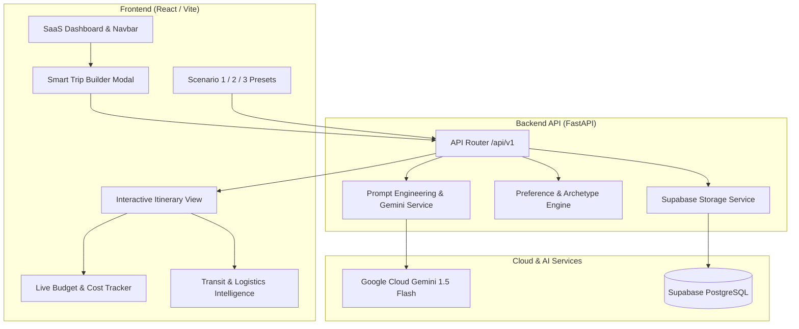

# ✈️ Personalized Travel Itinerary Planner

> **AI-Powered Full-Stack Travel Application** built with **React**, **FastAPI**, **Google Cloud Gemini AI**, and **Supabase**.  
> Developed for the **Generative AI with Google Cloud** Program on MySkillWallet.

---

## 🌟 Executive Summary

The **Personalized Travel Itinerary Planner** is a modern SaaS web application that simplifies travel planning through intelligent automation, prompt engineering, and generative AI. It eliminates decision fatigue by generating structured, day-by-day itineraries tailored to traveler preferences, budget limits, pacing, and group dynamics.

Every itinerary includes:
- **Curated Attractions**: Sequenced logically by geographic proximity to reduce transit overhead.
- **Dining Recommendations**: Breakfast, lunch, and atmospheric dinner venues matching dietary requirements.
- **Lodging & Stay Tiers**: Handpicked accommodations matching budget categories (hostel, boutique, luxury resort).
- **Logistics & Route Intelligence**: Airport transfer guides, local public transit pass suggestions, and packing essentials.
- **Live Budget Tracking**: Itemized cost calculations and visual progress indicators against user budget limits.
- **In-Place Modification**: One-click regeneration of individual days and drop-in activity swapping.

---

## 🧭 The 3 Curriculum Core Scenarios

The platform includes built-in one-click configurations for the three official project evaluation scenarios:

| Scenario | Destination | Persona & Budget | Key Features |
| :--- | :--- | :--- | :--- |
| **Scenario 1: Solo Traveler Weekend Getaway** | Barcelona, Spain (2 Days) | Solo Explorer • $650 Budget | Sagrada Família timed entry, Boqueria solo-counter tapas, Gothic Quarter walk, zero transit friction. |
| **Scenario 2: Couple Romantic Vacation** | Amalfi Coast & Positano, Italy (3 Days) | Romantic Couple • $2,400 Luxury | Private Capri Gozzo boat charter, Villa Cimbrone infinity terrace in Ravello, candlelit cliffside dinners. |
| **Scenario 3: Small Group Multi-Day Trip** | Kyoto & Osaka, Japan (4 Days) | Group of 4 • $3,600 Balanced | Arashiyama bamboo hike, Fushimi Inari, Dotonbori neon canal, ICOCA transit pass, vegetarian accommodation. |

---

## 🏗️ System Architecture



---

## 📋 Curriculum Epics Breakdown

- **Epic 1: Vibe Coding Environment Setup**: Configured modular repository structure, requirements, environment variables, and Docker containerization.
- **Epic 2: Supabase Database Setup**: Comprehensive PostgreSQL schema with `profiles`, `trips`, `itinerary_days`, `activities`, `user_preferences`, and Row-Level Security (RLS) policies.
- **Epic 3: Preference Collection & Recommendation Engine**: Dynamic scoring for traveler archetypes (Solo, Couple, Group, Family), interest vectors, and budget allocation models.
- **Epic 4: Itinerary Generation & Personalization**: Multi-shot prompt templates for Gemini AI with fallback heuristic engine, day regeneration, and activity swapping.
- **Epic 5: Productization & Interactive Frontend**: Modern Tailwind SaaS interface with scenario starter buttons, timeline view, and export features.
- **Epic 6: Deployment & Containerization**: Dockerfile, docker-compose, and single-file zero-dependency instant browser demo (`demo_preview/index.html`).
- **Epic 7: Final Testing & Documentation**: Submission guide, schema verification, and API documentation.

---

## 🚀 Quick Start Guide

### Option 1: Instant Interactive Demo (Zero Setup Required)
Open the standalone interactive app directly in your browser:
- Double click [`demo_preview/index.html`](file:///C:/Users/aruls/.gemini/antigravity/scratch/personalized-travel-planner/demo_preview/index.html) or run `start.bat` and select `[1]`.
- All features (Scenario 1, 2, 3, Trip Builder, Regeneration, Budget Tracker, PDF Export) work immediately with zero dependencies.

### Option 2: Running Full-Stack via Docker
```bash
docker compose up --build
```
- Frontend: `http://localhost:5173`
- Backend API Docs: `http://localhost:8000/docs`

### Option 3: Manual Local Development

#### 1. Backend (FastAPI)
```bash
cd backend
python -m venv venv
# On Windows:
.\venv\Scripts\activate
# On macOS/Linux:
source venv/bin/activate

pip install -r requirements.txt
cp .env.example .env
python run.py
```
Backend runs at `http://localhost:8000` with Swagger UI at `http://localhost:8000/docs`.

#### 2. Frontend (React + Vite)
```bash
cd frontend
npm install
npm run dev
```
Frontend runs at `http://localhost:5173`.

---

## 🗄️ Supabase Database Setup

1. Create a free project at [supabase.com](https://supabase.com).
2. Go to the **SQL Editor** tab in your Supabase dashboard.
3. Copy and run the contents of [`supabase/schema.sql`](file:///C:/Users/aruls/.gemini/antigravity/scratch/personalized-travel-planner/supabase/schema.sql).
4. Run the seed records in [`supabase/seed.sql`](file:///C:/Users/aruls/.gemini/antigravity/scratch/personalized-travel-planner/supabase/seed.sql).
5. Add your `SUPABASE_URL` and `SUPABASE_KEY` to `backend/.env`.

---

## 🤖 Google Cloud Gemini AI Configuration

1. Generate a free API key at [Google AI Studio](https://aistudio.google.com/).
2. Add your key to `backend/.env`:
   ```env
   GEMINI_API_KEY=your_gemini_api_key_here
   GEMINI_MODEL=gemini-1.5-flash
   ```
*(Note: If no API key is provided, the application automatically engages its smart heuristic engine to generate realistic itineraries offline without crashing).*

---

## 📦 Project Directory Layout

```
personalized-travel-planner/
├── backend/
│   ├── app/
│   │   ├── api/             # FastAPI REST endpoints
│   │   ├── models/          # Pydantic v2 schemas
│   │   ├── services/        # Gemini AI & Supabase integration
│   │   ├── data/            # Scenarios 1, 2, 3 datasets
│   │   ├── config.py        # Environment settings
│   │   └── main.py          # App entrypoint
│   ├── requirements.txt
│   └── run.py
├── frontend/
│   ├── src/
│   │   ├── components/      # SaaS Cards, Timelines, Builders
│   │   ├── pages/           # Dashboard & Views
│   │   ├── services/        # API & Supabase clients
│   │   └── App.jsx
│   ├── package.json
│   └── vite.config.js
├── supabase/
│   ├── schema.sql           # Complete DDL & RLS rules
│   └── seed.sql             # Preset data
├── demo_preview/
│   └── index.html           # Instant zero-dependency browser preview
├── docker-compose.yml
├── PROJECT_SUBMISSION_GUIDE.md
└── start.bat
```
